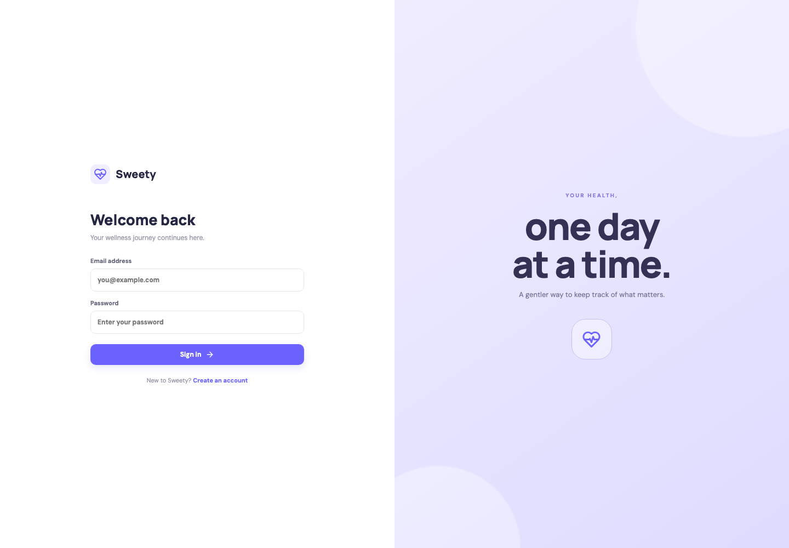

# Sweety – Blood Glucose Tracker

Sweety is a small, responsive full-stack glucose journal. People can securely register, log up to four daily readings, edit and delete their own entries, and review daily, month-to-date, and previous-calendar-month summaries.

## Features

- JWT authentication and bcrypt password hashes.
- Private, owner-scoped reading CRUD with duplicate slot and daily maximum enforcement.
- PostgreSQL date, range, and slot constraints; a unique user/date/slot key; transaction advisory lock for safe daily limits.
- Dashboard with selected-day stats, latest reading, and four check-in slots.
- History with date filtering and delete confirmation; reports with empty states and one-decimal averages.
- Responsive React UI.

## Stack

React 18, React Router, Axios, Vite, Express, Node.js, PostgreSQL, `pg`, bcryptjs, JWT, Jest, and Supertest.

## Structure

```text
client/src/{components,context,pages,services,utils}
server/src/{config,controllers,middleware,routes,utils,validators}
server/database/{migrations,schema.sql}
server/seeds/seed.js
server/tests/api.test.js
```

## Prerequisites and setup

- Node.js 20 or newer and npm.
- PostgreSQL 14 or newer.

Create the development and separate test databases (the tests clear their own configured database):

```sh
createdb sweety_db
createdb sweety_test_db
cp .env.example .env
```

Set `DATABASE_URL`, `TEST_DATABASE_URL`, and a private `JWT_SECRET` (at least 32 random characters) in `.env`. `CLIENT_URL` defaults to `http://localhost:5173`.

Install, migrate, seed, and run:

```sh
npm install
npm run install:all
npm run db:migrate
npm run db:seed
npm run dev
```

The API runs on port 5001 by default and Vite on port 5173. Set `PORT` in `.env` to use another available API port. If the API port is busy, the server prints a short message suggesting this setting. Run the client and API together from the repository root with `npm run dev`. To run separately, use `npm run dev --prefix server` and `npm run dev --prefix client`. The API health check is `GET /api/health`.

`npm run db:migrate` applies the idempotent initial schema. `npm run db:seed` creates/updates the demo user and replaces that user's sample readings (safe to run again). Demo login: `demo@sweety.com` / `Demo@12345`.

## API

All successful responses are JSON except delete (204). Failures use `{ "error": { "message": "...", "code": "..." } }`. Send `Authorization: Bearer <token>` on private calls. User IDs always come from the verified token.

| Method | Endpoint | Purpose |
|---|---|---|
| POST | `/api/auth/register` | Register `{name,email,password}` |
| POST | `/api/auth/login` | Login `{email,password}`, returns JWT |
| GET | `/api/auth/me` | Current account |
| POST | `/api/auth/logout` | Client token logout acknowledgement |
| GET/POST | `/api/readings` | List (optional `?date=YYYY-MM-DD`) / create `{reading_date,time_slot,glucose_value}` |
| GET/PUT/DELETE | `/api/readings/:id` | Read, replace fields, or delete owned entry |
| GET | `/api/dashboard?date=YYYY-MM-DD` | Daily stats and ordered readings |
| GET | `/api/reports/daily?date=...` | Selected date report |
| GET | `/api/reports/month-to-date?date=...` | First of month through selected date |
| GET | `/api/reports/monthly?date=...` | Previous calendar month |

Time slot values: `morning`, `after_breakfast`, `after_lunch`, `after_dinner`. Dates are strict ISO calendar dates. Glucose is an integer from 40 through 600 mg/dl.

## Tests

Set `TEST_DATABASE_URL` to a dedicated disposable PostgreSQL database with the same privileges as development, then run:

```sh
npm test
```

The integration tests clear user and reading rows in the configured test database. Never point `TEST_DATABASE_URL` at a database containing data you need.

## Screenshots



The screenshot is from the running React application. The dashboard, history, and report screens can be viewed after starting PostgreSQL, applying the migration, seeding the demo account, and signing in.

## Assumptions, limitations, and future work

- Four supported slots are fixed and ordered by the product requirements.
- Dates are stored as PostgreSQL `DATE`; the server uses its configured local current date for the future-date constraint. Set the database/server timezone consistently with the patient's locale when deploying.
- JWT logout is client-side token removal; stateless access tokens remain valid until expiry. A production deployment could use short-lived access tokens and revocable refresh tokens in secure, same-site cookies.
- There is no medical interpretation, alerting, provider sharing, or device integration; readings are a personal log, not medical advice.
- Future work: refresh-token rotation, accessible automated UI tests, exports, deployment automation, and patient-local timezone support.

## GitHub submission

The repository is configured with the requested GitHub remote. Commit history should describe logical milestones. Screenshots or a short screen recording can be added under `screenshots/` before submission.
